# Xivi — Design roadmap

Visual journey of the product UI from the original tutorial shell to today’s left-sidebar app shell. Screenshots live under [`docs/screenshots/`](./screenshots/).

← Back to [README](../README.md) · [Features](./FEATURES.md)

---

## At a glance

| Phase | Brand | Chrome | Home layout | Theme feel |
| ----- | ----- | ------ | ----------- | ---------- |
| **0** | MERN - Social Media | Top navbar + search | User card \| feed \| Sponsored | Dark + cyan (tutorial default) |
| **1** | MockBook | Top navbar (utilities + logout) | Feed + **Add people** rail | Forest green polish; light/dark |
| **2** | **Xivi** | Top navbar + account menu | Same shell; richer discover / Following | Stone + forest; brand-first auth |
| **3** | Xivi | **Left sidebar** + slim top bar (bell) | Centered feed only; People in rail | Same system; clearer IA |

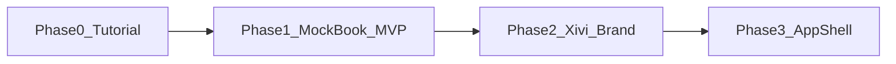

---

## Phase 0 — Tutorial baseline

**When:** Starting point (EdRoh-style MERN social tutorial).

**What it was:** A working demo of posts and friends with the stock three-column dashboard. Product identity was generic (“MERN - Social Media”). Auth forms were long; home mixed profile chrome, feed, and a sponsored ad.

### Screenshots

**Login — centered dark card, cyan CTA**

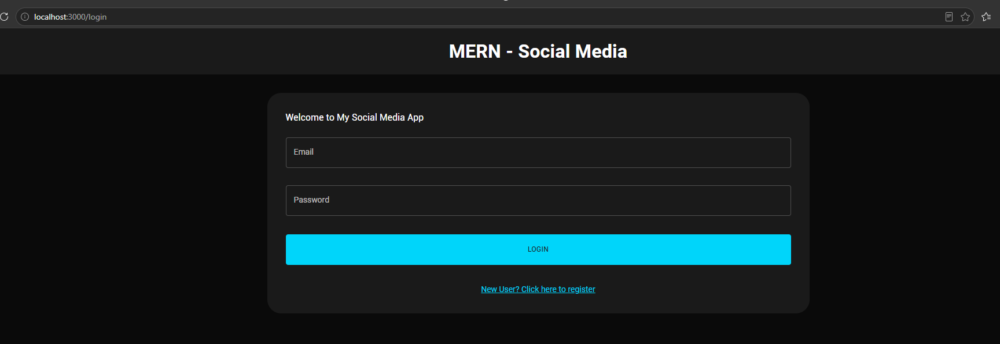

**Register — location, occupation, optional photo on signup**

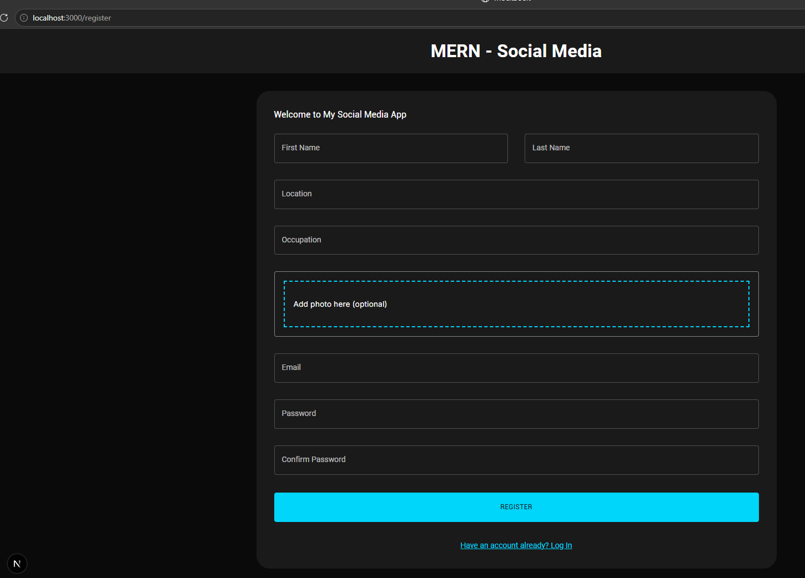

**Home — navbar search; left user widget; center compose; right Sponsored**

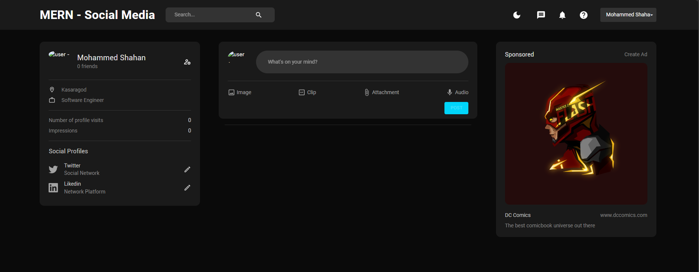

### Design characteristics

- Top bar: brand text, **Search…**, theme / chat / notifications / help, account pill
- Left: profile summary, visits, impressions, static “Social Profiles”
- Center: compose with Image / Clip / Attachment / Audio row + cyan **POST**
- Right: **Sponsored** ad card (placeholder for a real product)
- Dark-first cyan palette; no distinctive product brand

### Why we moved on

- Tutorial chrome ≠ a real product (ads, unused icons, long register)
- Search in the navbar promised discovery we did not own yet
- Hard to grow navigation (help, settings, people) without cluttering the top bar

---

## Phase 1 — MockBook: product MVP + first polish

**When:** Feature completion + early UI system (still named **MockBook** in these shots).

**What changed:** Dropped the tutorial ad and left-home profile clone. Built real social surfaces: comments, likes lists, save/share, profile tabs, notifications, and **Add people** as the home discovery rail. Navbar became utility-focused (theme, bell, help, logout). Theme shifted toward forest green instead of cyan.

### Screenshots

**Home — Everyone / Friends tabs; Add people rail; like / comment / save / share**

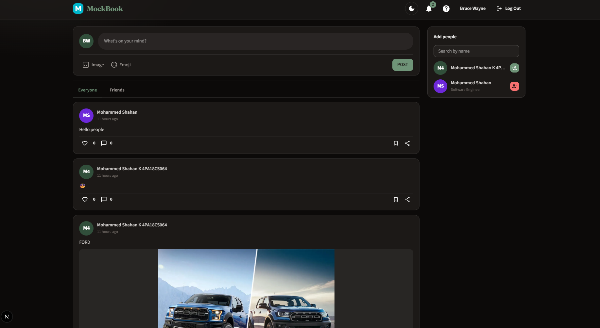

**Notifications menu in the top bar**

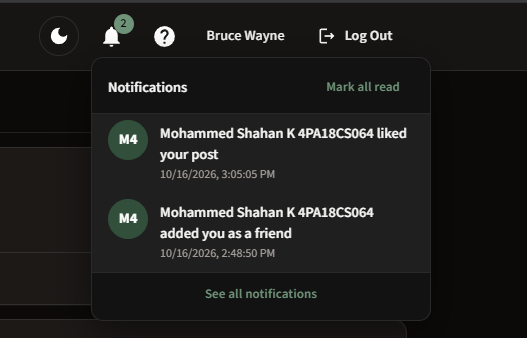

**Post with comments**

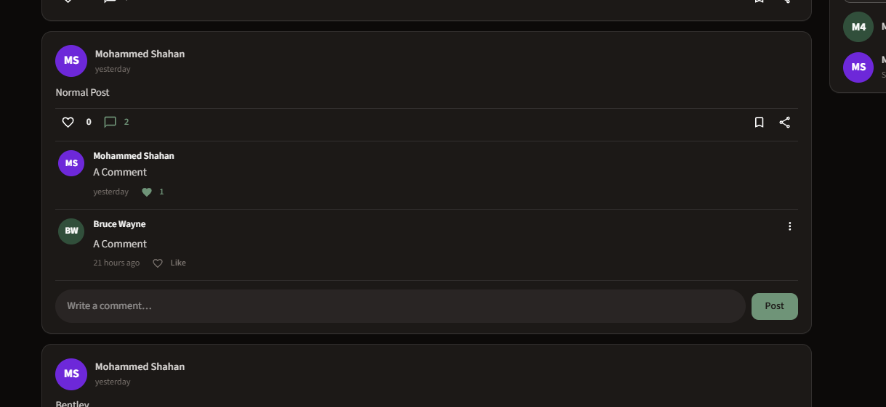

**Who liked a post**

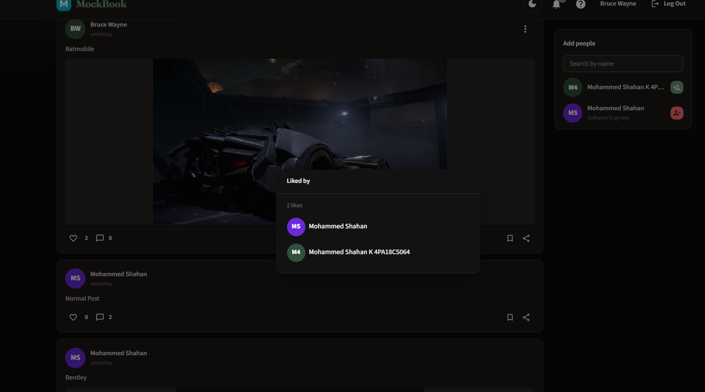

**Profile — Posts / Saved / Liked / Commented; friends on profile**

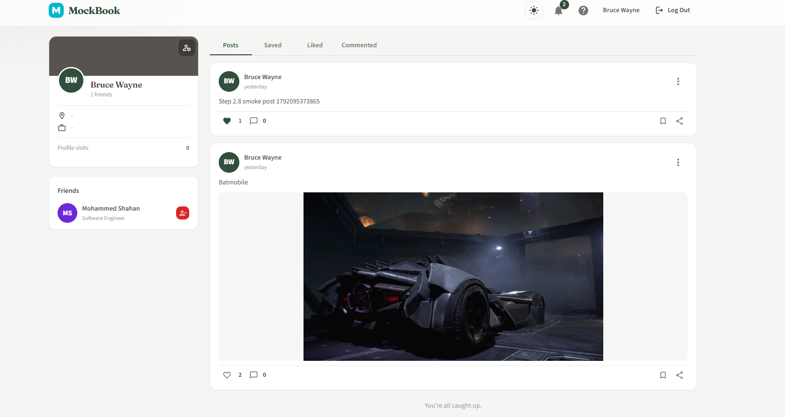

**Profile Liked tab**

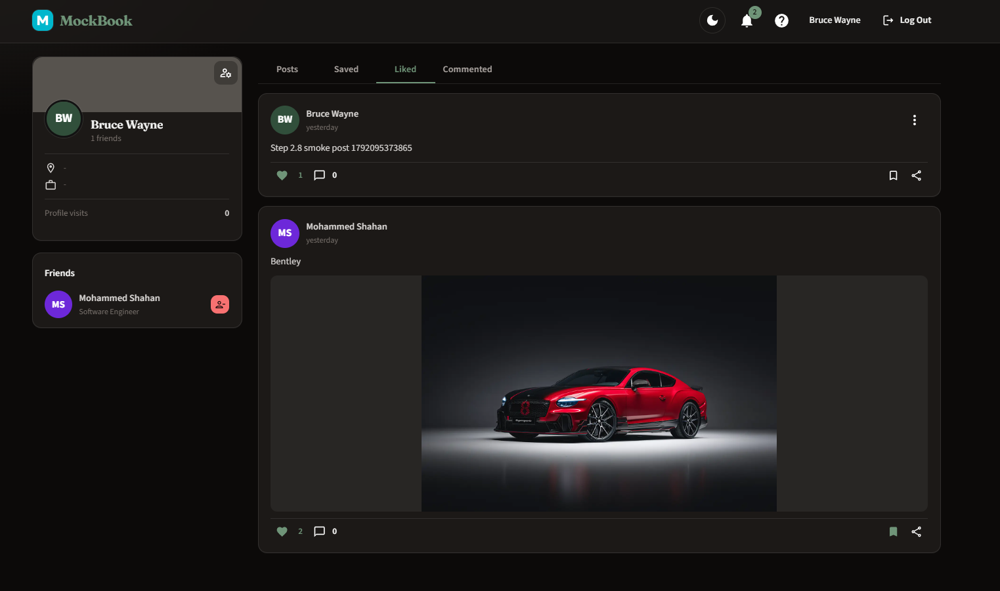

**Edit profile dialog**

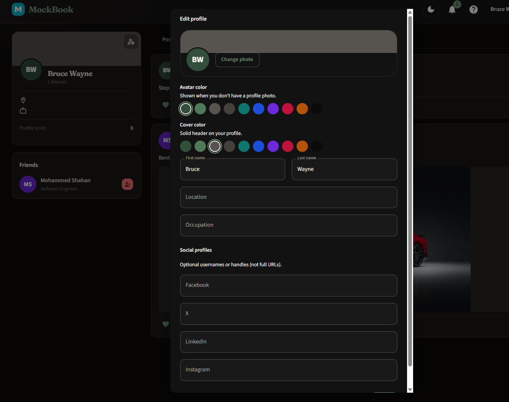

### Why these choices

| Choice | Reason | Advantage |
| ------ | ------ | --------- |
| Remove Sponsored / Clip / Audio | Not part of the product promise | Honest UI; less fake chrome |
| Friends list on **profile**, not home | Home is for the feed | Clearer jobs per screen |
| **Add people** right rail + in-widget search | Discovery without a broken navbar search | Search lives where results appear |
| Profile tabs (Posts / Saved / Liked / Commented) | Surface saves & engagement history | Users can find their activity again |
| Bell + notifications | Social apps need glanceable updates | Badge + dropdown + full page later |
| Forest green + light/dark | Step away from tutorial cyan | More “product,” less “template” |

### Still limited

- Brand still **MockBook** (interim name)
- Top navbar held theme, help, logout, and growing account actions
- Discover was only a sticky rail (no dedicated People page yet)

---

## Phase 2 — Xivi brand + social graph UX

**When:** Rebrand to **Xivi**, design-system pass, friend requests + follow, discover pagination.

**What changed:** Stronger identity (logo mark, Fraunces / Source Sans 3, stone + forest). Auth became a split brand/form layout. Home kept the top navbar + Add people rail, but discovery and relationships matured: **Following** feed, Follow + Friend actions, join dates, paginated Add people, path toward `/people`.

### Screenshot

**Home — Xivi mark; compact compose; Everyone / Following; Add people with Follow+Friend and pagination**

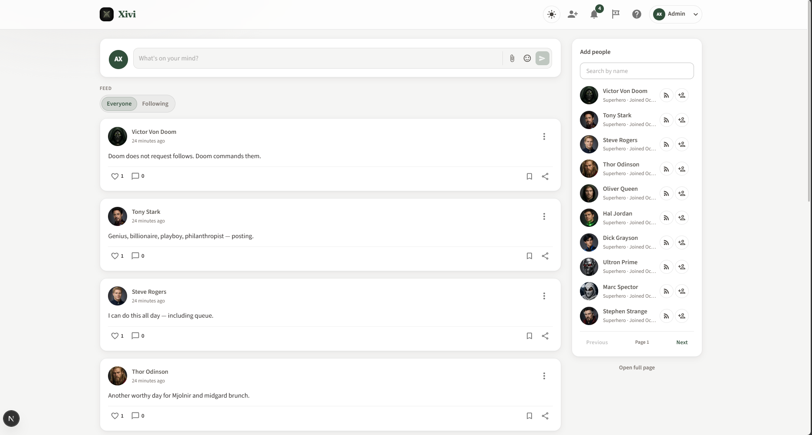

### Why these choices

| Choice | Reason | Advantage |
| ------ | ------ | --------- |
| Rename to **Xivi** + logo mark | Own a brand, not a tutorial title | Recognizable header and auth |
| Stone-first theme + display font | Distinctive without purple/AI clichés | Cohesive light/dark product look |
| Split auth layout + atmosphere images | Brand-first first viewport | Login/register feel intentional |
| **Following** tab (friends ∪ following) | One-way follow is not the same as mutual friends | Users understand the feed filter |
| Separate Follow vs Friend on lists | Different relationship semantics | Less confusion than a single “Add” |
| Paginated Add people + “Open full page” | Unbounded lists don’t scale | Home rail stays light; `/people` for deep search |
| Friend-request inbox + badges | Mutual friends need a request lifecycle | Clear pending state, not instant friends |
| Account menu in navbar | Logout / profile / Find people were crowding the bar | Cleaner top chrome |

### Still limited

- All destinations still competed in a **horizontal** navbar
- Home reserved a large column for Add people even when the user just wanted the feed
- Settings had nowhere natural to live for admins or future preferences

---

## Phase 3 — Left sidebar app shell

**When:** Current authenticated chrome (this revival pass).

**What changed:** Replaced the full top navbar with a **hybrid shell**:

- **Left rail** — where you go (Home, Find people, Friend requests, Profile; Settings, Help, tutorial, theme, account, logout)
- **Slim top bar** — glance actions (**notifications** bell only on desktop; hamburger + logo + bell on mobile)
- **Home** — full feed column (narrow max width ~720px); Add people rail and mobile “Find people” CTA removed (People lives in the rail / `/people`)
- **`/settings`** — users see coming soon; admins see a disabled Part 2 feature-catalog preview

### Screenshot

**Home — left sidebar + slim top bar with notification badge; centered feed**

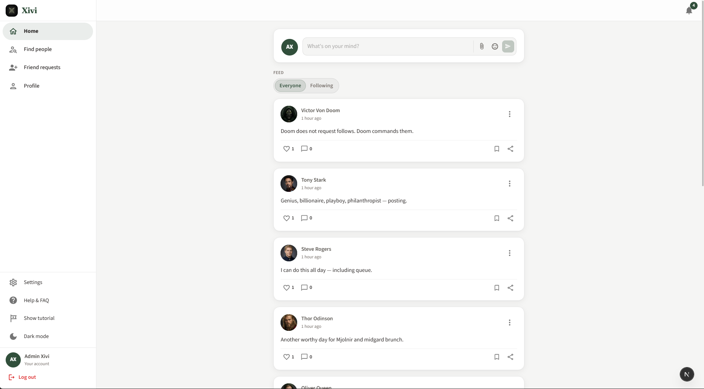

### Why these choices

| Choice | Reason | Advantage |
| ------ | ------ | --------- |
| Left sidebar for destinations | Top bar was overcrowded; social apps scale better with a rail | Room for Settings / Help / tutorial without icon soup |
| Notifications **only** in the top bar | Social habit is top-right bell; avoid two “notification homes” | Badge always visible while scrolling |
| No empty desktop top (slim bar kept) | Full blank top felt unfinished | Persistent glance strip without a second nav list |
| Friend requests in the rail | Dedicated list page, not only a dropdown | Discoverable; badge still works |
| Remove home Add people rail | Discover already has `/people` + rail link | Feed reads at a comfortable width; less competition |
| Narrow home content (~720px) | Ultra-wide cards stretch short text and actions apart | Better reading line length; intentional side gutters |
| Align logo row height with top bar | Mismatched borders looked like a bug | Continuous horizontal rule at the shell corner |
| Settings always in the rail | Prep for personal prefs + admin feature flags | One place; role decides content (empty vs catalog preview) |

### Trade-offs accepted

- Desktop top bar left side is intentionally sparse (brand lives in the rail)
- Empty gutters beside the narrow feed are background only — not a third column
- Admin feature toggles are **preview** until Part 2 API enforcement

---

## What we kept across phases

- Material UI + theme tokens (not a full redesign framework)
- Light / dark mode
- Compose → feed rhythm on Home
- Profile as the place for “me” (tabs, friends/followers/following over time)
- Notifications as a first-class product surface (menu + `/notifications`)

## What we deliberately left behind

- Tutorial **Sponsored** ads and unused media types (Clip / Audio)
- Navbar **Search** that did not search the product
- Instant “add friend” without requests
- Packing every destination into a top bar
- Ultra-wide single-column feeds after the rail was removed

---

## Screenshot index

| Phase | File | Shows |
| ----- | ---- | ----- |
| 0 | [`phase-0/login.png`](./screenshots/phase-0/login.png) | Tutorial login |
| 0 | [`phase-0/register.png`](./screenshots/phase-0/register.png) | Long register form |
| 0 | [`phase-0/home-feed-desktop.png`](./screenshots/phase-0/home-feed-desktop.png) | 3-column tutorial home |
| 1 | [`phase-1/home-feed-everyone.png`](./screenshots/phase-1/home-feed-everyone.png) | MockBook home + Add people |
| 1 | [`phase-1/notifications-menu.png`](./screenshots/phase-1/notifications-menu.png) | Bell dropdown |
| 1 | [`phase-1/post-comments.png`](./screenshots/phase-1/post-comments.png) | Comments on a post |
| 1 | [`phase-1/likers-dialog.png`](./screenshots/phase-1/likers-dialog.png) | Likers list |
| 1 | [`phase-1/profile-posts-tab.png`](./screenshots/phase-1/profile-posts-tab.png) | Profile Posts tab |
| 1 | [`phase-1/profile-liked-tab.png`](./screenshots/phase-1/profile-liked-tab.png) | Profile Liked tab |
| 1 | [`phase-1/edit-profile-dialog.png`](./screenshots/phase-1/edit-profile-dialog.png) | Edit profile |
| 2 | [`phase-2/home-feed-add-people.png`](./screenshots/phase-2/home-feed-add-people.png) | Xivi home + Follow/Friend rail |
| 3 | [`phase-3/home-feed-left-sidebar.png`](./screenshots/phase-3/home-feed-left-sidebar.png) | App shell + centered feed |

---

## Related docs

- [FEATURES.md](./FEATURES.md) — current feature list (including app shell + settings)
- [API.md](./API.md) · [SCHEMA.md](./SCHEMA.md) · [ERD.md](./ERD.md)
